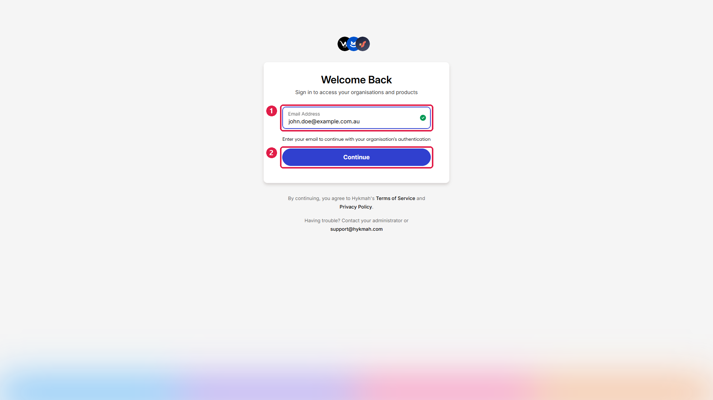
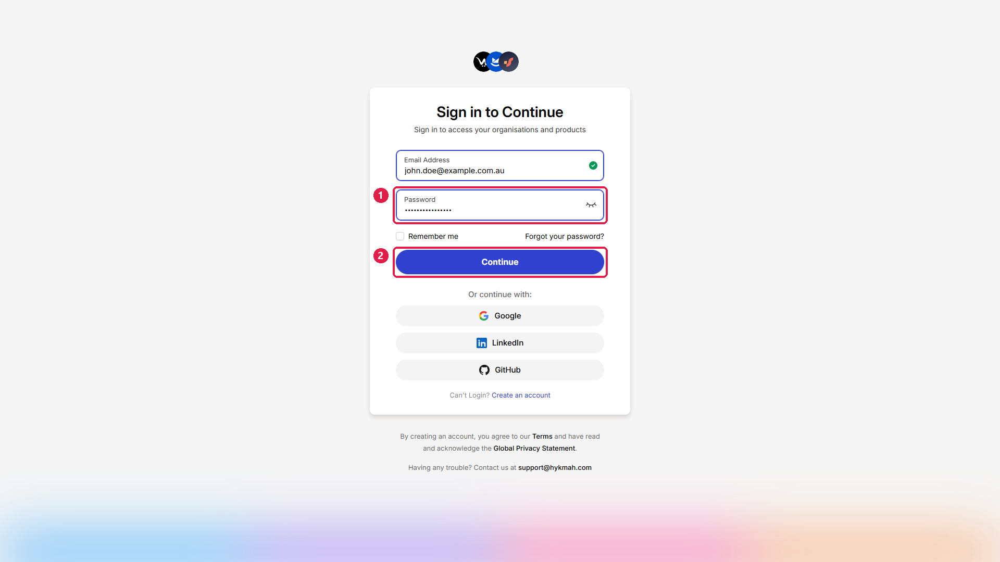
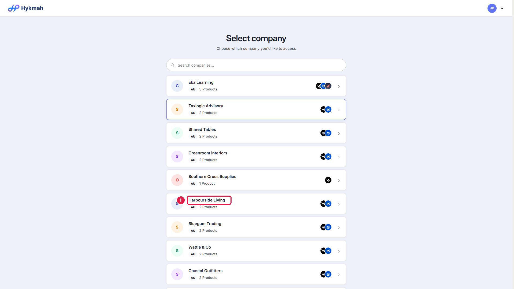
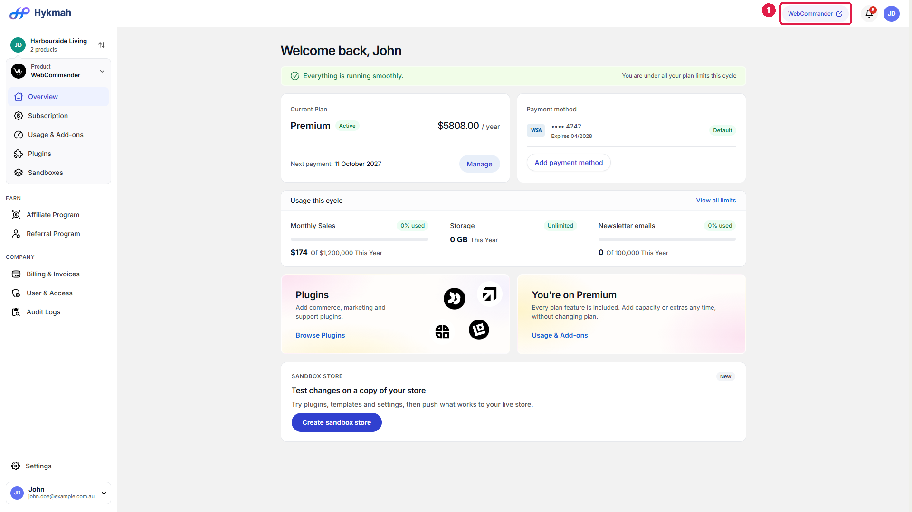
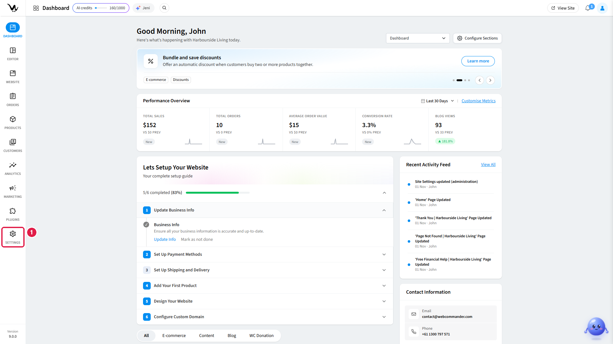
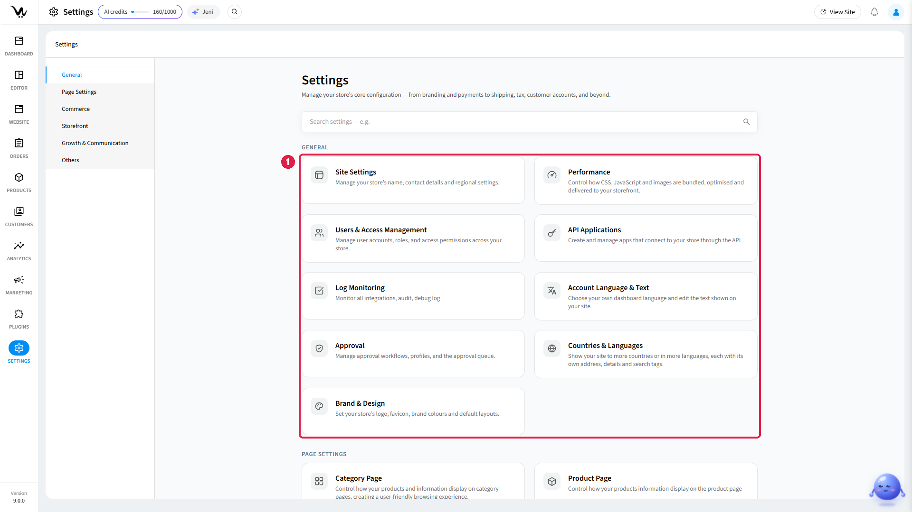
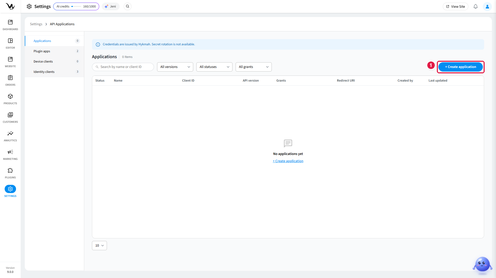
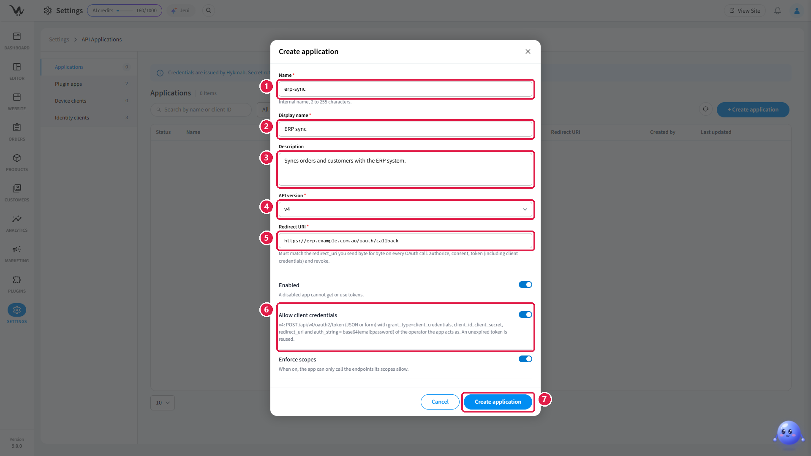

To call the API with [Authentication (New)](/authentication), your integration needs a **client ID** and
a **client secret**. Both belong to an API application, which you create in your store's WebCommander
admin. You reach the admin by signing in to Hykmah.

## Before you start

- A Hykmah account with access to the company that owns the store.
- Permission to change the store's settings in the WebCommander admin.

The numbers on each screenshot match the numbered actions in that step.

## Steps

<Steps>
  <Step title="Sign in to Hykmah">
    Go to [manage-hykmah.exsited.com](https://manage-hykmah.exsited.com/select-organisation). Enter your
    email address **(1)** and click **Continue (2)**.

    <Frame>
      
    </Frame>
  </Step>
  <Step title="Enter your password">
    Enter your password **(1)** and click **Continue (2)**. You can also sign in with Google, LinkedIn
    or GitHub if your account is linked to one of them.

    <Frame>
      
    </Frame>
  </Step>
  <Step title="Select your company">
    Under **Select company**, click the company that owns the store **(1)**. Use the search box if you
    have access to many companies.

    <Frame>
      
    </Frame>
  </Step>
  <Step title="Open the WebCommander admin">
    On the company dashboard, click **WebCommander (1)** in the top bar, next to the notifications bell.
    The WebCommander admin opens in a new browser tab.

    <Frame>
      
    </Frame>
  </Step>
  <Step title="Open Settings">
    In the WebCommander admin, click **Settings (1)** at the bottom of the left sidebar.

    <Frame>
      
    </Frame>
  </Step>
  <Step title="Open API Applications">
    Under **General**, click **API Applications (1)**.

    <Frame>
      
    </Frame>
  </Step>
  <Step title="Start a new application">
    Click **+ Create application (1)**. The list shows the store's existing applications; it is empty
    until you create the first one.

    <Frame>
      
    </Frame>
  </Step>
  <Step title="Fill in the application">
    Complete the form and click **Create application (7)**.

    <Frame>
      
    </Frame>

    | # | Field | What to enter |
    | --- | --- | --- |
    | 1 | **Name** | An internal name of 2 to 255 characters, such as `erp-sync`. |
    | 2 | **Display name** | The name shown in the admin, such as `ERP sync`. |
    | 3 | **Description** | Optional. What the integration does, so others can recognise it later. |
    | 4 | **API version** | Choose **v4**, the version the SDKs and this documentation use. |
    | 5 | **Redirect URI** | Required by the form. The new sign-in does not send it, but the [legacy token request](/authentication-legacy) must send exactly this value. |
    | 6 | **Allow client credentials** | Turn it on. Without it, the application cannot get an access token from its client ID and client secret. |
    | 7 | **Create application** | Saves the application. |

    Leave **Enabled** on: a disabled application cannot get or use tokens. **Enforce scopes** is on by
    default; while it is on, the application can call only the endpoints its scopes allow.
  </Step>
  <Step title="Copy the client ID and client secret">
    Hykmah issues the application's credentials. Copy the **client ID** and the **client secret** and
    store the secret in an environment variable or a secrets manager.

    <Warning>
      Secret rotation is not available. If the client secret is exposed, disable the application and
      create a new one.
    </Warning>
  </Step>
</Steps>

## Use the credentials

Give the SDK your store's base URL, the auth base URL and the two credentials. The SDK gets the access
token, caches it and renews it for you:

```bash
WC_BASE_URL=https://your-store.mywebcommander.com
WC_AUTH_BASE_URL=https://manage-hykmah-api.exsited.com
WC_CLIENT_ID=your-client-id
WC_CLIENT_SECRET=your-client-secret
```

[Authentication (New)](/authentication) shows the setup for every SDK and the token request for cURL.
