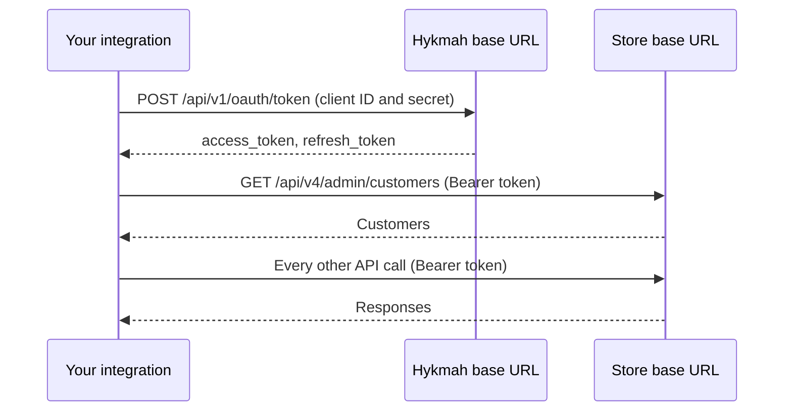
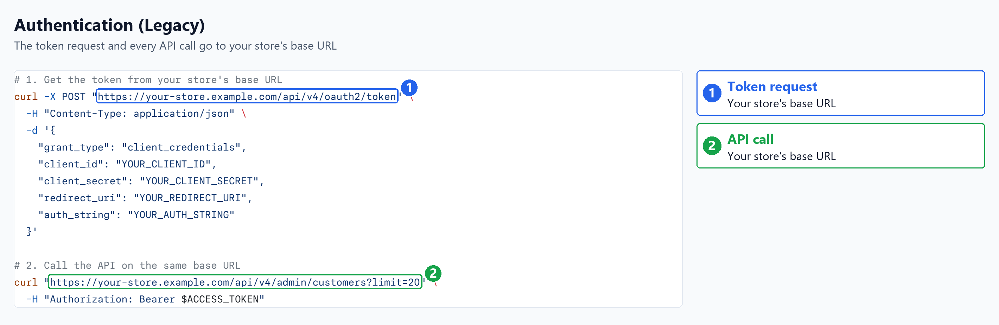
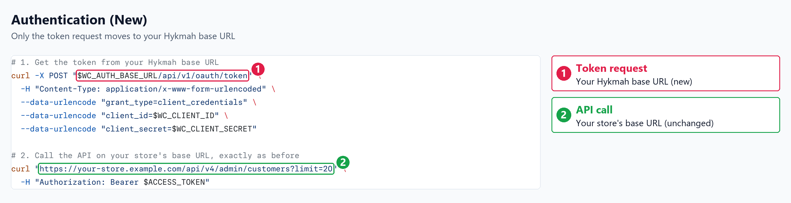

import ClientSetup from '/snippets/client-setup.mdx';
import ClientSetupBoth from '/snippets/client-setup-both.mdx';
import ClientBuild from '/snippets/client-build.mdx';

Every call to the API must include an access token. With the new sign-in, you create an API
application, and the SDKs get the token for you from its client ID and client secret, cache it and
renew it before it expires. With cURL, or any HTTP client, you request the token yourself and send it
with each call.

<Note>
  This page covers the new sign-in, which needs only a client ID and a client secret. If your store
  still uses a redirect URI and an auth string, follow [Authentication (Legacy)](/authentication-legacy)
  instead.
</Note>

The token request and the API calls go to two different addresses:

| Request | Goes to |
| --- | --- |
| Get or renew the access token | Your Hykmah base URL |
| Every API call | Your store's base URL |

<Info>
  Only the token request changes. Every API call still goes to your WebCommander store's base URL,
  with the same paths, parameters and responses as before. Your Hykmah base URL is used for nothing
  but getting and renewing the access token.
</Info>

## Which address each request uses

Your integration works with two addresses. Keep them apart:

- **Base URL** is your WebCommander store's own address, for example
  `https://your-store.example.com`. It is the same address you use today, and every API call goes to
  it: customers, orders, products, settings and every other endpoint in this documentation.
- **Hykmah base URL** is the address that issues access tokens. Your integration sends exactly one
  kind of request there: getting or renewing a token. It never receives an API call.

### Example: one token request, then normal API calls

Say your store is at `https://your-store.example.com`. With the new sign-in, the requests your
integration makes look like this:

<Steps>
  <Step title="Get a token from your Hykmah base URL">
    ```bash
    curl -X POST "$WC_AUTH_BASE_URL/api/v1/oauth/token" \
      -H "Content-Type: application/x-www-form-urlencoded" \
      --data-urlencode "grant_type=client_credentials" \
      --data-urlencode "client_id=$WC_CLIENT_ID" \
      --data-urlencode "client_secret=$WC_CLIENT_SECRET"
    ```

    The response holds `access_token`. This is the only request that goes to your Hykmah base URL.
  </Step>
  <Step title="Call the API on your store's base URL, as before">
    ```bash
    curl "https://your-store.example.com/api/v4/admin/customers?limit=20" \
      -H "Authorization: Bearer $ACCESS_TOKEN"

    curl "https://your-store.example.com/api/v4/admin/orders?limit=20" \
      -H "Authorization: Bearer $ACCESS_TOKEN"
    ```

    The address, path, parameters and response are exactly what they were with the legacy sign-in.
    Only the token in the `Authorization` header came from somewhere else.
  </Step>
  <Step title="Renew the token on your Hykmah base URL when it expires">
    Send the same token request with `grant_type=refresh_token` and your `refresh_token`. Then keep
    calling your store's base URL with the new token.
  </Step>
</Steps>

With an SDK you never write these requests yourself. You give the client both addresses once, and it
sends the token request to your Hykmah base URL and every API call to your store's base URL:

```bash
WC_BASE_URL=https://your-store.example.com   # every API call
WC_AUTH_BASE_URL=your-hykmah-base-url        # token requests only
WC_CLIENT_ID=your-client-id
WC_CLIENT_SECRET=your-client-secret
```



### What changes from the legacy sign-in

The two screenshots below show the same task in each sign-in: get a token, then list customers. The
marked addresses are the only difference. In the legacy sign-in both requests go to your store's base
URL **(1, 2)**. In the new sign-in only the token request moves to your Hykmah base URL **(1)**; the API
call stays on your store's base URL **(2)**.

<Frame caption="Authentication (Legacy): the token request and the API call both go to your store's base URL.">
  
</Frame>

<Frame caption="Authentication (New): only the token request goes to your Hykmah base URL; the API call is unchanged.">
  
</Frame>

| | Authentication (Legacy) | Authentication (New) |
| --- | --- | --- |
| Where the token request goes | Your store's base URL, `POST /api/v4/oauth2/token` | Your Hykmah base URL, `POST /api/v1/oauth/token` |
| Token request body | JSON with `grant_type`, `client_id`, `client_secret`, `redirect_uri` and `auth_string` | Form data with `grant_type`, `client_id` and `client_secret` |
| Where API calls go | Your store's base URL | Your store's base URL (**unchanged**) |
| API paths, parameters and responses | `/api/v4/...` | Same (**unchanged**) |
| How the token is sent | `Authorization: Bearer ACCESS_TOKEN` | Same (**unchanged**) |

Moving an existing integration to the new sign-in therefore means changing only how it gets the
token. With an SDK, add the Hykmah base URL option and drop the redirect URI and auth string; leave
the base URL and every call exactly as they are.

### Common mistakes

<AccordionGroup>
  <Accordion title="Sending API calls to the Hykmah base URL">
    The Hykmah base URL only issues tokens. A call such as `GET /api/v4/admin/customers` sent there
    fails. Send every API call to your store's base URL.
  </Accordion>
  <Accordion title="Replacing the base URL with the Hykmah base URL">
    Keep `WC_BASE_URL` set to your store's address. The Hykmah base URL is a separate, additional
    setting (`WC_AUTH_BASE_URL`), not a replacement.
  </Accordion>
  <Accordion title="Requesting the token from the store">
    With the new sign-in, `POST /api/v4/oauth2/token` on your store is the legacy token request and
    expects a redirect URI and an auth string. Request the token from your Hykmah base URL instead.
  </Accordion>
  <Accordion title="Sending the token request as JSON">
    The token request on your Hykmah base URL accepts form data only
    (`application/x-www-form-urlencoded`). A JSON body is rejected with `400`.
  </Accordion>
</AccordionGroup>

## Your credentials

| Credential | What it is |
| --- | --- |
| Base URL | Your store's address, including `https://`. Every API call goes here. |
| Hykmah base URL | The address that issues access tokens. Only the token request goes here. |
| Client ID | Identifies your API application. |
| Client secret | The secret paired with the client ID. |

You get the client ID and client secret when you create an API application in the WebCommander admin.
See [Create API Application](/api-application) for the steps. There is no redirect URI and no auth
string to configure.

<Warning>
  The client secret gives access to your store's data. Keep it in an environment variable or a secrets
  manager, never in source code.
</Warning>

## Set up a client

Register your credentials once, when your app starts. These samples read them from environment
variables named `WC_BASE_URL`, `WC_AUTH_BASE_URL`, `WC_CLIENT_ID` and `WC_CLIENT_SECRET`.
`WC_AUTH_BASE_URL` holds your Hykmah base URL, the one new setting. The cURL tab shows the token
request itself, sent as form data.

<ClientSetup />

Then get a client wherever you make calls. Every SDK sample in the API reference starts this
way:

<ClientBuild />

The registration turns on the raise-on-error option (`raise_on_error=True` in Python) for every
client you build, so a failed call raises an exception or throws an error instead of going
unnoticed. A `200` whose body contains `"isSuccess": false` also counts as a failure: the API
returns that for a URL it cannot route, such as `/api/v4/admin/customerz`.

The Hykmah base URL option is named `auth_base_url` in Python, `authBaseUrl` in JavaScript, PHP, Java
and Dart, `AuthBaseUrl` (a property, passed as `authBaseUrl:`) in .NET and `AuthBaseURL` in Go.

## What the SDKs handle

<CardGroup cols={2}>
  <Card title="Getting the token" icon="key">
    On the first call, the SDK sends your client ID and client secret to your Hykmah base URL and gets
    an access token.
  </Card>
  <Card title="Caching and renewal" icon="rotate">
    The SDK caches the token and renews it before it expires, trying the refresh token first.
  </Card>
  <Card title="An expired token" icon="clock-rotate-left">
    If a call returns `401` because the token has expired, the SDK refreshes the token once and sends
    the call again.
  </Card>
  <Card title="A real refusal" icon="ban">
    Any other `401`, such as a wrong `old_password` when you change a password, is returned to you
    and not retried, so a write is never sent twice.
  </Card>
</CardGroup>

## Calling the API directly

Request a token from `POST /api/v1/oauth/token` on your Hykmah base URL. Send the body as form data with
the header `Content-Type: application/x-www-form-urlencoded`. A JSON body is rejected with `400`. The
fields are:

| Field | Value |
| --- | --- |
| `grant_type` | `client_credentials` |
| `client_id` | Your client ID. |
| `client_secret` | Your client secret. |

The cURL tab under [Set up a client](#set-up-a-client) shows the full request. A successful request
returns `200 OK` with these fields:

| Field | Meaning |
| --- | --- |
| `access_token` | The token to send with each call. |
| `token_type` | Always `Bearer`. |
| `expires_in` | Seconds until the token expires. Currently `3600`. |
| `refresh_token` | Exchanged for a new access token when this one expires. |
| `scope` | The access the token grants. |

Send the access token in the `Authorization` header on every call. These calls go to your store's base
URL, not to your Hykmah base URL. For example, with a store at `https://your-store.example.com`:

```bash
# 1. Get the token from your Hykmah base URL
curl -X POST "$WC_AUTH_BASE_URL/api/v1/oauth/token" \
  -H "Content-Type: application/x-www-form-urlencoded" \
  --data-urlencode "grant_type=client_credentials" \
  --data-urlencode "client_id=$WC_CLIENT_ID" \
  --data-urlencode "client_secret=$WC_CLIENT_SECRET"

# 2. Call the API on your store's base URL, exactly as before
curl "https://your-store.example.com/api/v4/admin/customers?limit=20" \
  -H "Authorization: Bearer $ACCESS_TOKEN"
```

### Renewing the token

Before the token expires, exchange the refresh token for a new one. Send a form to the same URL with
`grant_type` set to `refresh_token`, your `refresh_token`, and your client ID and client secret:

```bash
curl -X POST "$WC_AUTH_BASE_URL/api/v1/oauth/token" \
  -H "Content-Type: application/x-www-form-urlencoded" \
  --data-urlencode "grant_type=refresh_token" \
  --data-urlencode "refresh_token=$REFRESH_TOKEN" \
  --data-urlencode "client_id=$WC_CLIENT_ID" \
  --data-urlencode "client_secret=$WC_CLIENT_SECRET"
```

The response has the same fields as the first request. The SDKs do this for you.

## Using both sign-ins in one app

One app can talk to a store that uses the new sign-in and to a store that still uses the legacy one.
Register one configuration for each and give each a client name. The configuration with an auth base
URL signs in the new way. The one without it signs in with its redirect URI and auth string, as
described in [Authentication (Legacy)](/authentication-legacy). Build a client by name to choose which
store you call; with no name you get the first one registered.

These samples read the second store's credentials from environment variables that start with
`WC_LEGACY_`:

<ClientSetupBoth />

## Try it in the docs

Every endpoint page has a **Try it** button that calls your store from this site.

<Steps>
  <Step title="Get a token">
    Request a token from your Hykmah base URL with the cURL request in
    [Calling the API directly](#calling-the-api-directly), and copy `access_token` from the response.
  </Step>
  <Step title="Call an endpoint">
    Open any endpoint, click **Try it**, set `store` to your store's host name (without `https://`),
    paste the token into **Authorization**, and click **Send**.
  </Step>
</Steps>

<Warning>
  These calls run against your real store: creating, changing and deleting data is real. Requests
  are sent through Mintlify's servers. Use test data, and never share your credentials.
</Warning>
